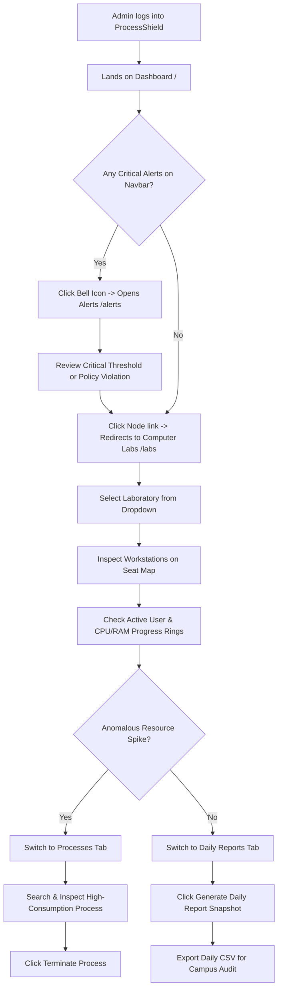
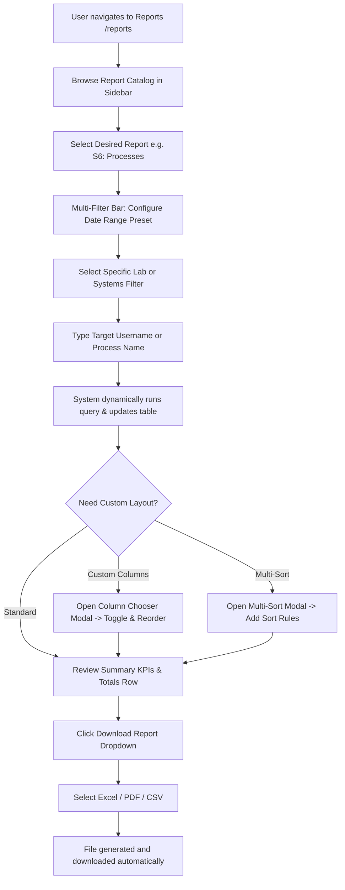
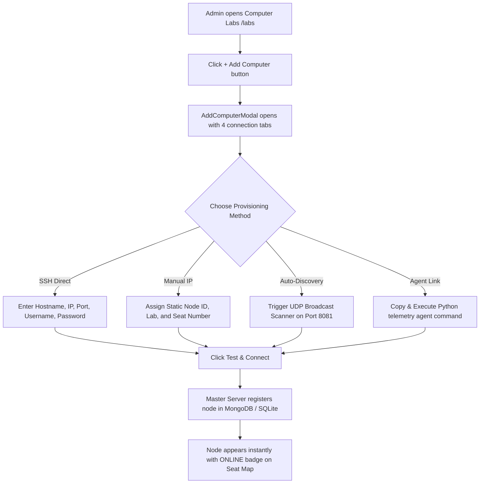
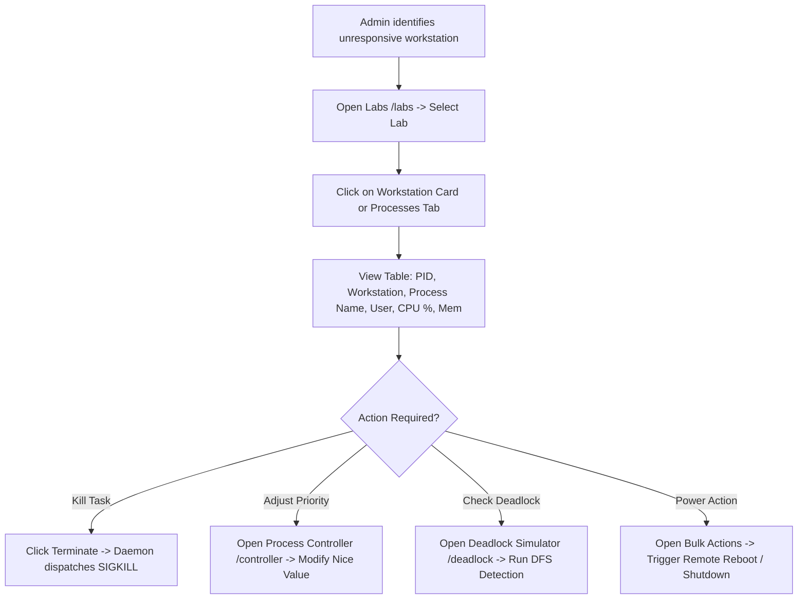

# ProcessShield UI/UX Design Architecture & Component Flow Guide

> **Document Version:** 2.0  
> **Target Audience:** UI/UX Designers, Frontend Engineers, System Architects  
> **Purpose:** Comprehensive analysis of the current UI/UX layout, component placement, interactive elements, user flows, and page-by-page functionality. Designed as a foundational reference for the upcoming user-friendly redesign and structural rearrangement.

---

## Table of Contents

1. [Global Design System & Layout Architecture](#1-global-design-system--layout-architecture)
   - [Design Tokens, Palette & Aesthetics](#design-tokens-palette--aesthetics)
   - [Global Shell Hierarchy (Sidebar, Navbar, Viewport)](#global-shell-hierarchy)
   - [Typography & Component Standards](#typography--component-standards)
2. [Global Navigation & Routing Map](#2-global-navigation--routing-map)
3. [Page-by-Page Detailed Breakdown (All 17 Pages)](#3-page-by-page-detailed-breakdown)
   - [3.1 Authentication: Login (`/login`)](#31-authentication-login-login)
   - [3.2 Primary: Dashboard (`/`)](#32-primary-dashboard-)
   - [3.3 Central Hub: Computer Labs (`/labs`)](#33-central-hub-computer-labs-labs)
   - [3.4 Business Intelligence: Enterprise Reports (`/reports`)](#34-business-intelligence-enterprise-reports-reports)
   - [3.5 Daily Telemetry & Hardware Audits: Daily Reports (`/daily-reports`)](#35-daily-telemetry--hardware-audits-daily-reports-daily-reports)
   - [3.6 Fleet Management: Workstations / Devices (`/devices`)](#36-fleet-management-workstations--devices-devices)
   - [3.7 Process Resource Monitoring: Processes (`/processes`)](#37-process-resource-monitoring-processes-processes)
   - [3.8 Performance Diagnostics: CPU Analyzer (`/cpu-analyzer`)](#38-performance-diagnostics-cpu-analyzer-cpu-analyzer)
   - [3.9 Memory Diagnostics: Memory Analyzer (`/memory-analyzer`)](#39-memory-diagnostics-memory-analyzer-memory-analyzer)
   - [3.10 Remote Process Control: Process Controller (`/controller`)](#310-remote-process-control-process-controller-controller)
   - [3.11 OS Safety & DFS Cycle Detection: Deadlock Simulator (`/deadlock`)](#311-os-safety--dfs-cycle-detection-deadlock-simulator-deadlock)
   - [3.12 Resource Allocation: Banker's Algorithm (`/bankers`)](#312-resource-allocation-bankers-algorithm-bankers)
   - [3.13 Incident Response: Alerts & Alarms (`/alerts`)](#313-incident-response-alerts--alarms-alerts)
   - [3.14 Audit Trails: System & SSH Logs (`/logs`)](#314-audit-trails-system--ssh-logs-logs)
   - [3.15 Software Asset Management: Software Inventory (`/software`)](#315-software-asset-management-software-inventory-software)
   - [3.16 Virtual Fleet & Stress Testing: Simulator (`/simulator`)](#316-virtual-fleet--stress-testing-simulator-simulator)
   - [3.17 Platform Administration: System Settings (`/settings`)](#317-platform-administration-system-settings-settings)
4. [Cross-Application User Flows](#4-cross-application-user-flows)
   - [User Flow 1: Daily Lab Monitoring & Incident Triaging](#user-flow-1-daily-lab-monitoring--incident-triaging)
   - [User Flow 2: Reporting, Multi-Filtering & Data Exporting](#user-flow-2-reporting-multi-filtering--data-exporting)
   - [User Flow 3: Workstation Onboarding & SSH Auto-Discovery](#user-flow-3-workstation-onboarding--ssh-auto-discovery)
   - [User Flow 4: Process Investigation & Remote Intervention](#user-flow-4-process-investigation--remote-intervention)
5. [UX Evaluation & Opportunities for Redesign](#5-ux-evaluation--opportunities-for-redesign)
   - [Current Strengths](#current-strengths)
   - [Identified Friction Points & Usability Gaps](#identified-friction-points--usability-gaps)
   - [Proposed Information Architecture (IA) Redesign Blueprint](#proposed-information-architecture-ia-redesign-blueprint)

---

## 1. Global Design System & Layout Architecture

ProcessShield uses an institutional desktop dashboard aesthetic built on **React 18**, **Tailwind CSS**, and **Lucide React**.

### Design Tokens, Palette & Aesthetics

| Token Category | Color / Value | Usage & Visual Role |
| :--- | :--- | :--- |
| **Canvas Background** | `#f0f4f9` | Soft, daylight-neutral slate tint reducing optical strain during extended monitoring. |
| **Card / Surface** | `#ffffff` / `bg-white/80 backdrop-blur-md` | Elevated frosted containers with subtle 1px border (`border-slate-200/80`). |
| **Primary Brand** | `#1d68ff` (Electric Royal Blue) | Interactive actions, active sidebar state, focus rings, primary metric indicators. |
| **User Highlighting** | `#4338ca` (Indigo-700 / `bg-indigo-50`) | Standardized styling for the active **`User`** column and user identity chips. |
| **Success / Online** | `#10b981` (Emerald-500) | Online node heartbeat, compliant policy indicators, safe algorithm state. |
| **Warning / Caution** | `#f59e0b` (Amber-500) | Approaching resource thresholds (CPU/RAM > 75%), high-load warnings. |
| **Critical / Danger** | `#ef4444` (Rose-500) | Deadlock cycles, offline nodes, unhandled incidents, process termination actions. |
| **Subtle Ambient Wave** | `bg-gradient-to-bl from-blue-500/15` | Fixed top-right radial blur (`blur-3xl`) providing visual depth behind cards. |

### Global Shell Hierarchy

```
+---------------------------------------------------------------------------------------------------------+
| [ProcessShield Logo]   | [Search Bar (⌘K)]                      [Atlas: Online] [Bell: (3)] [User Menu v] | <- Navbar (h-16 sticky)
+------------------------+--------------------------------------------------------------------------------+
| SIDEBAR (w-64 sticky)  | MAIN VIEWPORT CONTAINER (max-w-[1600px] p-5 sm:p-7)                           |
|                        |                                                                                |
| [Dashboard]            | +----------------------------------------------------------------------------+ |
| [Computer Labs]        | | PageHeader: Title + Subtitle + Action Area / Quick Filters                 | |
| [Reports]              | +----------------------------------------------------------------------------+ |
| [Daily Reports]        |                                                                                |
|                        | [Content Area: KPI Grids, Charts, Multi-Filter Bars, Data Tables, Modals]    |
| ---------------------- |                                                                                |
| [User Card & Role]     |                                                                                |
| [Fleet Online: 5 Nodes]|                                                                                |
+------------------------+--------------------------------------------------------------------------------+
```

1. **Sidebar (`Sidebar.tsx`)**:
   - Fixed 64-unit width (`w-64`), full viewport height, pinned to the left.
   - Top Header: Shield icon badge + application name + tagline.
   - Core Navigation List: Curated into 4 primary everyday operational sections: **Dashboard**, **Computer Labs**, **Reports**, **Daily Reports**.
   - Footer: Active user chip with initial avatar, role indicator, logout button, and live pulsed workstation counter.
2. **Top Navbar (`Navbar.tsx`)**:
   - Sticky top bar with frosted glass effect (`bg-white/80 backdrop-blur-md`).
   - Left: Global Search Input with `⌘K` keyboard shortcut pill.
   - Right: Real-time Database Health indicator (MongoDB Atlas connection status), Notification Bell with red pulse dot for unread alerts, and User Profile Dropdown (Settings, Labs Hub, Sign Out).
3. **Main Content Viewport (`<main>`)**:
   - Centered container constrained to `max-w-[1600px]`, dynamically responsive across mobile (`p-5`) and desktop (`p-7`).

---

## 2. Global Navigation & Routing Map

| Route Path | Component | Protected | Sidebar Listed | Role & Access |
| :--- | :--- | :---: | :---: | :--- |
| `/login` | `Login.tsx` | No | No | Public Authentication Gate |
| `/` | `Dashboard.tsx` | Yes | **Yes** | Fleet-wide Resource & Telemetry Overview |
| `/labs` | `Labs.tsx` | Yes | **Yes** | Multi-Lab Seat Map, Systems, Processes, Schedules |
| `/reports` | `Reports.tsx` | Yes | **Yes** | Enterprise BI Reporting Engine (System, Lab, College) |
| `/reports/:id` | `Reports.tsx` | Yes | No | Direct Report Deep-link (e.g. `/reports/S6`) |
| `/daily-reports`| `DailyReports.tsx` | Yes | **Yes** | Daily Hardware Audit Logs & Aggregated Telemetry |
| `/devices` | `Devices.tsx` | Yes | Accessible | Detailed Workstation Hardware Specifications |
| `/processes` | `Processes.tsx` | Yes | Accessible | Fleet-wide Process Manager & Search |
| `/cpu-analyzer`| `CPUAnalyzer.tsx` | Yes | Accessible | Granular CPU Core Analytics & Thread Frequency |
| `/memory-analyzer`| `MemoryAnalyzer.tsx` | Yes | Accessible | Physical RAM, Virtual Memory, Swap & Leak Detection |
| `/controller` | `ProcessController.tsx` | Yes | Accessible | Remote Process Termination & Nice Level Prioritization |
| `/deadlock` | `Deadlock.tsx` | Yes | Accessible | Wait-For Graph 3-Color DFS Cycle Simulator |
| `/bankers` | `BankersAlgorithm.tsx`| Yes | Accessible | Banker's Algorithm Safe State Matrix Evaluation |
| `/alerts` | `Alerts.tsx` | Yes | Navbar Bell | Threshold Alarms, Policy Violations & Incident Triage |
| `/logs` | `LogsPage.tsx` | Yes | Accessible | System Event Logs, SSH Commands & Agent History |
| `/software` | `SoftwareInventory.tsx`| Yes | Accessible | Global Installed Packages & Application Registry |
| `/simulator` | `SimulatorPage.tsx` | Yes | Accessible | Virtual Cluster Node Telemetry Generator |
| `/settings` | `SettingsPage.tsx` | Yes | Navbar User | Threshold Values, SSH Credentials & Server Config |

---

## 3. Page-by-Page Detailed Breakdown

---

### 3.1 Authentication: Login (`/login`)

#### Purpose
The secure entry barrier preventing unauthenticated access to system controls, workstation shells, and telemetry data.

#### Visual Layout & Component Placement
- **Background:** Soft daylight canvas (`#f0f4f9`) with two large radial gradients (top-left blue and bottom-right indigo blur).
- **Centered Card (`max-w-md`):**
  1. **Brand Identity:** Shield emblem in blue ring, "ProcessShield" heading, and subtitle.
  2. **Card Container:** Pure white frosted card with soft 40px drop shadow.
  3. **Header:** "Sign In to Dashboard" with explanatory text.
  4. **Error Alert:** Conditional rose-colored alert banner appearing if credentials fail.
  5. **Form Controls:**
     - Username input with user icon prefix.
     - Password input with lock icon prefix and eye toggle button (show/hide password).
     - "Remember this workstation" checkbox.
  6. **Primary Action Button:** Full-width electric blue button ("Sign In to Dashboard" with right arrow).
  7. **Quick Demo Pill:** Clickable "Use Admin Demo Credentials" button that auto-populates `admin` / `admin123`.

#### Interactive Functions & State
- Form submission validates input, initiates JWT authentication via `useAuthStore.login()`.
- On success, automatically redirects the user to their previously requested protected route or default `/`.

---

### 3.2 Primary: Dashboard (`/`)

```
+--------------------------------------------------------------------------------------------------+
| PageHeader: Dashboard - "Real-time system monitoring and resource management"                    |
+--------------------------------------------------------------------------------------------------+
| [CPU Usage: 24.2%]      | [Memory Usage: 4.82 GB]  | [Active Processes: 154] | [Alerts: 2 Active]    |
| Live Host | Sparkline   | 4.82/15.89 GB | Sparkline| 154 Running             | 1 Critical, 1 Warning |
+----------------------------------------------------+---------------------------------------------+
| Resource Usage Timeline (Area Chart 2/3 width)     | Resource Distribution (Donut Chart 1/3)     |
| [Live] [1H] [6H] [24H] [7D]                        | [Used: 30%] [Free: 62%] [Cached: 8%]        |
| - Blue Area: CPU Utilization                       | ------------------------------------------- |
| - Green Area: RAM Utilization                      | Host Specifications: OS, Arch, Cores, Uptime|
+----------------------------------------------------+---------------------------------------------+
| Active Workstations Monitor (Grid of System Cards)                                               |
| Filter by Lab: [All Labs v]                                                                      |
| +-------------------------+ +-------------------------+ +-------------------------+              |
| | sjt418scope065 [ONLINE] | | sjt418scope066 [ONLINE] | | SJT515-IOT03 [ONLINE]   |              |
| | CPU: [====    ] 22%     | | CPU: [======  ] 48%     | | CPU: [===     ] 18%     |              |
| | RAM: [======  ] 45%     | | RAM: [========] 64%     | | RAM: [====    ] 32%     |              |
| | User: jenkins           | | User: utkarsh           | | User: Administrator     |              |
| | [Inspect Workstation ->]| | [Inspect Workstation ->]| | [Inspect Workstation ->]|              |
| +-------------------------+ +-------------------------+ +-------------------------+              |
+--------------------------------------------------------------------------------------------------+
| Quick Access Navigation (Banker's, Deadlock, Labs Hub, Reports, Controller)                      |
+--------------------------------------------------------------------------------------------------+
```

#### Component Placement Hierarchy
1. **PageHeader:** Top left title and contextual subtitle.
2. **Top Metric Cards (4 Columns):**
   - **Card 1: CPU Usage:** Primary host CPU %, live status dot, SVG sparkline curve.
   - **Card 2: Memory Usage:** Used RAM in GB, total host RAM, % occupied, SVG sparkline curve.
   - **Card 3: Active Processes:** Current count of running OS processes, active threads.
   - **Card 4: System Alerts:** Count of pending alarms with colored level badge.
3. **Telemetry Charts Grid (Split 2:1):**
   - **Left (2/3 width):** Recharts Area Chart displaying dynamic historical trends for CPU and RAM with timeframe selector buttons (`Live`, `1H`, `6H`, `24H`, `7D`).
   - **Right (1/3 width):** Recharts Donut Pie Chart illustrating RAM distribution (Used vs Free vs Cache) coupled with host hardware specifications (CPU architecture, kernel, network IP).
4. **Active Workstations Fleet Grid:**
   - Lab filter dropdown.
   - Workstation cards showing hostname, seat badge, IP, status pill, CPU bar, RAM bar, active **User**, and "Inspect Workstation" button.
5. **Inspect Workstation Modal:**
   - Triggered by clicking "Inspect Workstation" on any card.
   - Contains 4 tabs: `Live Processes` (with kill action), `Telemetry History`, `Installed Software`, `Recent Sessions`.

---

### 3.3 Central Hub: Computer Labs (`/labs`)

```
+--------------------------------------------------------------------------------------------------+
| PageHeader: Computer Labs - "Multi-laboratory workstation fleet management & real-time seat maps"|
| [Lab Selector Dropdown: Computer Science Lab 1 v]  [+ Add Computer]  [Bulk Lab Actions v]        |
+--------------------------------------------------------------------------------------------------+
| Sub-Navigation Tabs:                                                                             |
| [1. Workstations & Seat Map] [2. Processes] [3. Daily Reports] [4. Software] [5. Schedules]       |
+--------------------------------------------------------------------------------------------------+
| TAB 1: WORKSTATIONS & SEAT MAP                                                                   |
| [Search Workstations...]  Status: [All v] [Online] [In-Use] [Offline]     Total: 20 | Online: 18 |
|                                                                                                  |
| +-------------------------+ +-------------------------+ +-------------------------+              |
| | Seat #01 | sjt418scope65| | Seat #02 | sjt418scope66| | Seat #03 | SJT515-IOT03 |              |
| | OS: Ubuntu Linux        | | OS: Ubuntu Linux        | | OS: Windows 11 Pro      |              |
| | IP: 10.30.151.65        | | IP: 10.30.151.66        | | IP: 10.30.151.105       |              |
| | User: [jenkins]         | | User: [utkarsh]         | | User: [Administrator]   |              |
| | CPU: 12% | RAM: 44%     | | CPU: 65% | RAM: 72%     | | CPU: 24% | RAM: 32%     |              |
| | [Edit Seat] [Transfer]  | | [Edit Seat] [Transfer]  | | [Edit Seat] [Transfer]  |              |
| | [Delete Node (Red Bin)] | | [Delete Node (Red Bin)] | | [Delete Node (Red Bin)] |              |
| +-------------------------+ +-------------------------+ +-------------------------+              |
+--------------------------------------------------------------------------------------------------+
| TAB 2: WORKSTATION PROCESSES                                                                     |
| Node: [All Workstations v]  [Search Process...]  Category: [All] [Applications] [Background]     |
| TABLE: PID | Workstation | Process Name | User | Category | CPU % | GPU % | Memory | State       |
+--------------------------------------------------------------------------------------------------+
| TAB 3: DAILY REPORTS                                                                             |
| Node: [All Workstations v]  [Generate Daily Report (Snapshot)]  [Export CSV]                     |
| TABLE: Date | Workstation | User | Avg CPU | Peak CPU | Avg GPU | Peak GPU | Avg RAM | Uptime   |
+--------------------------------------------------------------------------------------------------+
```

#### Purpose
The central administrative hub for managing lab computers, seat assignments, live processes, daily performance audits, software packages, and schedules.

#### Interactive Components & Workflows
1. **Lab Switcher & Bulk Actions Header:**
   - Dropdown to switch active laboratory context (e.g. CS Lab 1, AI Lab, IoT Lab).
   - "Add Computer" button opening `AddComputerModal` with 4 connection methods (SSH remote credentials, Manual IP, Auto-Discovery UDP beacon, Agent script download).
   - "Bulk Lab Actions" menu: Mass shutdown, mass reboot, lock screens, log off users, broadcast message.
2. **Sub-Navigation Tabs:**
   - **Tab 1: Workstations & Seat Map:**
     - Search bar for workstation hostname, user, or IP.
     - Status filter pills (`ALL`, `ONLINE`, `IN_USE`, `OFFLINE`).
     - Card grid with real-time CPU/RAM progress rings, OS badge, active user tag, seat number badge.
     - In-card actions: Edit seat number inline, transfer workstation to another lab, delete workstation node with red confirmation modal.
   - **Tab 2: Workstation Processes:**
     - Filter by specific workstation node.
     - Search by process name or PID.
     - Category filter (User Applications vs System Daemons).
     - Standardized Process Table: `PID`, `Workstation`, `Process Name`, `User` (styled cleanly), `Category`, `CPU %`, `GPU %`, `Memory RSS`, `State`.
     - Action to kill process remotely.
   - **Tab 3: Daily Reports:**
     - "Generate Daily Report" button compiling an instant telemetry snapshot.
     - "Export CSV" button.
     - Historical audit log table with date, workstation, **User**, CPU metrics, GPU metrics, RAM, and uptime.
   - **Tab 4: Software:**
     - Scanned package inventory for workstations in the lab.
     - Version, publisher, installation date, and storage footprint.
   - **Tab 5: Schedules:**
     - Timetable of academic sessions, course codes, instructor names, start/end times.

---

### 3.4 Business Intelligence: Enterprise Reports (`/reports`)

```
+--------------------------------------------------------------------------------------------------+
| PageHeader: Reports - "Comprehensive hardware telemetry, session logs, and compliance analytics" |
| Active: S6 - Processes Report [Category: System]           [Reset Filters] [Save Preset]         |
+--------------------------------------+-----------------------------------------------------------+
| REPORT CATALOG SIDEBAR (w-72)        | MAIN REPORT WORKSPACE                                     |
| [Search Reports Catalog...]          |                                                           |
|                                      | MULTI-FILTER BAR:                                         |
| SYSTEM REPORTS:                      | [Date Range: Last 30 Days v] [Labs: All Labs v]           |
| - S1: System Utilization             | [Systems: All Systems v] [User: Search User...]           |
| - S2: Performance & Telemetry (GPU)  | --------------------------------------------------------- |
| - S3: Memory Usage                   | ACTION BAR:                                               |
| - S4: Disk Usage                     | [Columns (9 Visible)] [Multi-Sort] [Download Report v]    |
| - S5: Installed Software Inventory   |                                     |- Excel (.xlsx)      |
| - S6: Processes (GPU & User)  <--    |                                     |- PDF Document       |
| - S7: Hardware Inventory             |                                     |- CSV Spreadsheet    |
| - S8: Uptime and Downtime            | --------------------------------------------------------- |
| - S9: Faults and Maintenance         | SUMMARY KPI TILES:                                        |
|                                      | [Tracked Processes: 150] [Fleet Avg CPU: 13.0%]           |
| LAB REPORTS:                         | --------------------------------------------------------- |
| - L2: Lab Usage Trend                | VISUAL CHARTS: (Bar / Area / Trendline where applicable)  |
| - L4: Session Log                    | --------------------------------------------------------- |
| - L7: Alerts & Incidents             | DATA GRID TABLE:                                          |
| - L11: Idle-logged-in                | Lab | System | Process Name | User | CPU % | GPU % | Mem  |
| - L12: Out-of-hours Usage            | CS1 | node67 | python3      | antony| 20.5% | 0.0%  | 2048 |
|                                      | CS1 | node66 | opencode     | utkarsh| 30.4% | 3.0%  | 1344 |
| COLLEGE REPORTS:                     | CS1 | IOT03  | Antigravity  | Admin | 27.7% | 0.0%  | 403  |
| - C1: College Summary                | --------------------------------------------------------- |
| - C2: Lab Comparison                 | TOTALS FOOTER: Average / Sum aggregates                   |
|                                      | PAGINATION: [< Prev] Page 1 of 6 [Next >]  Page Size: 25  |
+--------------------------------------+-----------------------------------------------------------+
```

#### Purpose
Institutional reporting engine enabling filtering, sorting, previewing, and exporting 12 standardized system, lab, and college-level reports.

#### Component Breakdown
1. **Left Catalog Sidebar (`ReportCatalog.tsx`):**
   - Search filter to quickly locate reports.
   - Categorized accordions: **System Reports** (S1-S9), **Lab Reports** (L2, L4, L7, L11, L12), **College Reports** (C1, C2).
   - Selection indicator highlighting the currently active report.
2. **Multi-Filter Bar (`FilterBar.tsx`):**
   - Date range selector presets (`Today`, `Yesterday`, `Last 7 Days`, `Last 30 Days`, `Semester to Date`, `Custom Range`).
   - Lab multi-select dropdown.
   - System / Workstation multi-select dropdown.
   - User text search input.
   - Software/Process name input.
3. **Action Bar:**
   - **Columns Button:** Opens `ColumnChooserModal` to show/hide and reorder columns.
   - **Multi-Sort Button:** Opens `MultiSortModal` to sort by multiple columns with ascending/descending rules.
   - **Download Dropdown:** Generates `.xlsx` (Excel), `.pdf` (formatted document), or `.csv`.
4. **Summary KPI Strip:**
   - Top 2-4 highlight metrics computed dynamically from server rollups.
5. **Interactive Data Table:**
   - Standardized **`User`** column rendered in bold indigo for assigned users and muted italic when unassigned.
   - Formatted cells: percentages, memory footprints in MB/GB, formatted ISO timestamps.
   - Summary footer row calculating column sums or averages.
   - Pagination bar with page size selection (`10`, `25`, `50`, `100`).

---

### 3.5 Daily Telemetry & Hardware Audits: Daily Reports (`/daily-reports`)

#### Purpose
Dedicated page for reviewing daily workstation performance rollups, GPU metrics, uptime percentages, and daily hardware compliance.

#### Visual Layout & Component Placement
- **Top Control Header:**
  - Lab Selector dropdown.
  - Workstation Node Selector dropdown.
  - "Generate Daily Report" trigger button.
  - "Export CSV" button.
- **KPI Summary Grid (6 Cards):**
  - Average CPU %, Peak CPU %, Average GPU %, Peak GPU %, Average RAM %, Fleet Uptime %.
- **Daily Reports History Table:**
  - Columns: `Report Date`, `User`, `Average CPU`, `Peak CPU`, `Average GPU`, `Peak GPU`, `Average RAM`, `Peak RAM`, `Uptime %`, `Samples Count`.

---

### 3.6 Fleet Management: Workstations / Devices (`/devices`)

#### Purpose
Hardware asset management inventory detailing every physical workstation and virtual VM across the campus network.

#### Visual Layout & Component Placement
- **PageHeader:** Node count, online count, offline count.
- **Device Table:**
  - Hostname, IP address, MAC address, Operating System with platform icon, Kernel version, CPU model & cores, Total RAM, System status badge (`ONLINE` in green, `OFFLINE` in red).
  - Row actions: "View Metrics", "Remote Terminal", "Power Options".

---

### 3.7 Process Resource Monitoring: Processes (`/processes`)

#### Purpose
Dedicated fleet-wide process monitor displaying running tasks across any selected workstation.

#### Visual Layout & Component Placement
- **Header Filter Bar:**
  - Target Node selector dropdown.
  - Search bar matching PID, process name, or user.
  - Category filter pills: `All Processes`, `User Applications`, `System Daemons`.
- **Process Table:**
  - PID, Process Icon + Name, User, CPU %, RAM (MB), Status.
  - Action button: Terminate Process (SIGKILL/SIGTERM).

---

### 3.8 Performance Diagnostics: CPU Analyzer (`/cpu-analyzer`)

#### Purpose
In-depth CPU performance diagnostic page analyzing multi-core thread load, context switching, and CPU usage spikes.

#### Visual Layout & Component Placement
- **Top Controls:** Target workstation selector.
- **Per-Core Visualization Grid:** Visual load bar for Core 0 through Core N.
- **CPU Frequency & Thread Statistics:** Real-time clock speed, thread count, interrupt rate.
- **Top CPU Consumer Processes Table.**

---

### 3.9 Memory Diagnostics: Memory Analyzer (`/memory-analyzer`)

#### Purpose
Virtual and physical memory analyzer identifying memory leaks, swap space usage, and buffer caches.

#### Visual Layout & Component Placement
- **Memory Breakdown Progress Bar:** Visual stacked representation of Used RAM, Cached RAM, Buffers, and Free RAM.
- **Swap Space Utilization Gauge.**
- **Top Memory Consumers Table:** Displays RSS, VMS, and % of physical memory consumed per process.

---

### 3.10 Remote Process Control: Process Controller (`/controller`)

#### Purpose
Administrative process control center allowing system administrators to adjust process priorities (nice values) and remotely suspend/resume tasks.

#### Visual Layout & Component Placement
- **Target Workstation Selector.**
- **Process Action Table:**
  - PID, Name, Priority/Nice Level slider/selector (-20 to +19).
  - Action buttons: Pause (`SIGSTOP`), Resume (`SIGCONT`), Terminate (`SIGTERM`), Force Kill (`SIGKILL`).

---

### 3.11 OS Safety & DFS Cycle Detection: Deadlock Simulator (`/deadlock`)

#### Purpose
Operating systems resource allocation graph (RAG) analyzer that uses 3-color Depth-First Search (DFS) to detect circular wait deadlock conditions.

#### Visual Layout & Component Placement
- **Header:** "Run DFS Detector" button.
- **Scenario Selection Cards (3 Cards):**
  1. *Classic 2-Process Deadlock* ($P_1 \leftrightarrow P_2$)
  2. *3-Process Cycle Deadlock* ($P_1 \to P_2 \to P_3 \to P_1$)
  3. *Safe Non-Circular Wait State*
- **Visual Graph & Cycle Path:**
  - Displays circular dependencies (e.g. `P1 -> R1 -> P2 -> R2 -> P1`).
  - Highlights involved processes in red alert banners.

---

### 3.12 Resource Allocation: Banker's Algorithm (`/bankers`)

#### Purpose
Interactive simulation of Dijkstra's Banker's Algorithm for deadlock avoidance, safety sequence determination, and dynamic resource allocation requests.

#### Visual Layout & Component Placement
- **Scenario Toggle:** `Classic SAFE (5P, 3R)` vs `UNSAFE Starved`.
- **Safety Status Banner:** Green "SYSTEM IS IN A SAFE STATE" with Safe Sequence (e.g. $P_1 \to P_3 \to P_4 \to P_0 \to P_2$) or Red "UNSAFE STATE".
- **Safety Matrices Grid:**
  - Allocation Matrix $[n \times m]$
  - Max Claim Matrix $[n \times m]$
  - Need Matrix $[n \times m]$ ($\text{Need} = \text{Max} - \text{Allocation}$)
  - Available Resource Vector
- **Interactive Resource Request Form:**
  - Select Process ($P_0$ - $P_4$).
  - Enter requested instances for Resources A, B, C.
  - "Evaluate & Request" button testing safety before granting.

---

### 3.13 Incident Response: Alerts & Alarms (`/alerts`)

#### Purpose
Real-time central incident board aggregating CPU/RAM threshold breaches, unauthorized processes, and connectivity timeouts.

#### Visual Layout & Component Placement
- **Filter Cards Row:** `All Alarms`, `Critical`, `Warnings`, `Info`.
- **Alert Feed Table:**
  - Severity Icon, Timestamp, Workstation Node, Incident Message, Triggered Value, Action (Acknowledge / Dismiss).

---

### 3.14 Audit Trails: System & SSH Logs (`/logs`)

#### Purpose
System audit log viewer for tracking administrator remote commands, SSH connections, policy updates, and daemon events.

#### Visual Layout & Component Placement
- **Log Stream Filters:** Severity selector, date selector, keyword search.
- **Monospaced Log Console:** Color-coded terminal entries with timestamps, user source, and command output.

---

### 3.15 Software Asset Management: Software Inventory (`/software`)

#### Purpose
Campus-wide software license and inventory manager tracking installed applications across all workstations.

#### Visual Layout & Component Placement
- **Workstation Selector & Category Filter:** Productivity, Development, Utilities, Browsers.
- **"Rescan Software Inventory" button.**
- **Software Table:** Package Name, Version, Publisher, Installation Date, Size in MB, Compliance Status.

---

### 3.16 Virtual Fleet & Stress Testing: Simulator (`/simulator`)

#### Purpose
Telemetry generator enabling administrators to spin up virtual nodes and simulate stress loads for testing without physical machines.

#### Visual Layout & Component Placement
- **Simulation Master Switch:** "Start Virtual Fleet" / "Stop Virtual Fleet".
- **Virtual Node Cards:** 3 virtual servers (Ubuntu Web Server, Windows Engineering Station, Debian Database Node) displaying simulated CPU/RAM oscillation.

---

### 3.17 Platform Administration: System Settings (`/settings`)

#### Purpose
Global configuration panel for setting telemetry polling rates, database connection strings, SSH credentials, and alert thresholds.

#### Visual Layout & Component Placement
- **Configuration Cards:**
  - Database Connection (MongoDB Atlas status, cluster name).
  - Telemetry & Polling Cadence (Agent push rate, rollup interval).
  - Alert Thresholds (Warning CPU %, Critical RAM %, Idle session timeout).
  - Master Agent API Key.
- **Save Changes Button.**

---

## 4. Cross-Application User Flows

### User Flow 1: Daily Lab Monitoring & Incident Triaging



---

### User Flow 2: Reporting, Multi-Filtering & Data Exporting



---

### User Flow 3: Workstation Onboarding & SSH Auto-Discovery



---

### User Flow 4: Process Investigation & Remote Intervention



---

## 5. UX Evaluation & Opportunities for Redesign

### Current Strengths
1. **Clean Visual Hierarchy:** Consistent Daylight palette (`#f0f4f9`) with vibrant blue interactive accents and card containers.
2. **Unified Data Format:** All reports feature the standardized **`User`** column rendered in bold indigo for clear active user identification.
3. **Comprehensive Feature Set:** Covers telemetry, hardware inventory, process control, operating system algorithm simulations (Banker's & Deadlock), and enterprise reporting.
4. **Real-time Live Telemetry:** WebSockets (Socket.IO) feed real-time CPU, RAM, and process counts without requiring full-page reloads.

### Identified Friction Points & Usability Gaps

| Area | Current UX Friction | Impact on User Experience |
| :--- | :--- | :--- |
| **Sidebar Isolation** | Only 4 pages are visible in the left sidebar (`Dashboard`, `Labs`, `Reports`, `Daily Reports`). Pages like `CPU Analyzer`, `Memory Analyzer`, `Deadlock`, and `Bankers` have no permanent sidebar navigation link. | Users must rely on dashboard quick links or remember direct URLs to access core diagnostic pages. |
| **Duplicate Daily Reports** | Daily reports exist both as a standalone page (`/daily-reports`) and as a tab inside Computer Labs (`/labs` -> `Daily Reports` tab). | Redundancy confuses users about where to generate or export daily audit snapshots. |
| **Information Density in Labs** | The Computer Labs page has 5 tabs, modal triggers, bulk actions, and nested filters, making it visually crowded on smaller laptop screens. | High cognitive load for administrators trying to quickly check seat availability. |
| **Modal Overuse** | Inspecting workstations, adding computers, choosing columns, and configuring multi-sort all open separate modal dialogs. | Breaks user flow and context; closing a modal loses sub-navigation state. |
| **Disconnected Diagnostic Tools** | `CPU Analyzer` and `Memory Analyzer` are separate pages, while `Processes` and `Controller` are also split. | Users investigating a slow machine must jump between 3-4 separate screens instead of a unified single-machine view. |

---

### Proposed Information Architecture (IA) Redesign Blueprint

To maximize user-friendliness in the upcoming redesign, the 17 pages can be consolidated into **4 intuitive navigation tiers** in the sidebar:

```
+--------------------------------------------------------------------------------------------------+
| PROPOSED REDESIGNED SIDEBAR STRUCTURE                                                            |
+--------------------------------------------------------------------------------------------------+
| 1. MONITORING & OPERATIONS                                                                       |
|    - Dashboard (Fleet overview, live alerts, top consumers)                                      |
|    - Computer Labs Hub (Consolidated seat map, live workstations, quick power controls)          |
|                                                                                                  |
| 2. SYSTEM DIAGNOSTICS & CONTROL (Unified Workspace)                                             |
|    - Workstation Diagnostics (Merges Devices, CPU Analyzer, Memory Analyzer & Processes into   |
|      a tabbed single-view console)                                                               |
|    - Process & Remote Controller (Kill, prioritize, pause/resume, bulk power)                    |
|                                                                                                  |
| 3. AUDIT & REPORTING                                                                             |
|    - Enterprise Reports (Centralized reporting engine including S1-S9, L1-L12, C1-C3)            |
|    - Daily Audits (Merged daily snapshots with one-click export)                                 |
|    - Software Inventory (Campus package registry & compliance)                                   |
|                                                                                                  |
| 4. ALGORITHMS & SIMULATION                                                                       |
|    - OS Algorithm Lab (Banker's Algorithm & DFS Deadlock Simulator side-by-side)                 |
|    - Fleet Simulator (Virtual node generator)                                                    |
|                                                                                                  |
| 5. SYSTEM SETTINGS & AUDIT                                                                       |
|    - Incident Logs & Alerts (Merged alert triage & event journal)                                |
|    - Platform Settings (Thresholds, SSH keys, database)                                          |
+--------------------------------------------------------------------------------------------------+
```

---

## Conclusion
This document captures the current structure, visual components, interaction patterns, and user journeys of ProcessShield. Use the component wireframes, state variables, and information architecture blueprints above as the direct design reference during your UI/UX layout rearrangement.
